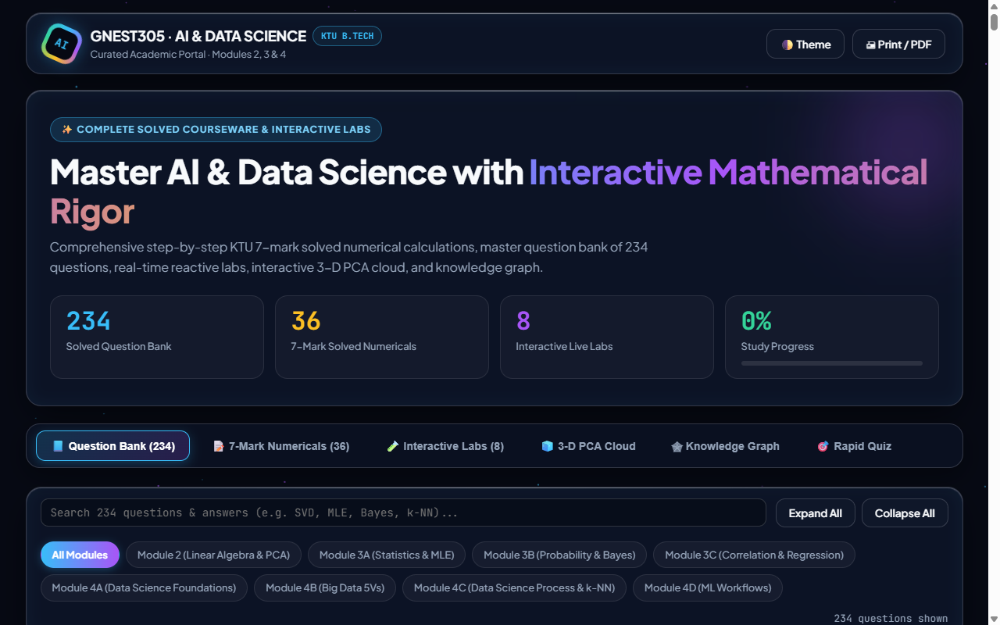
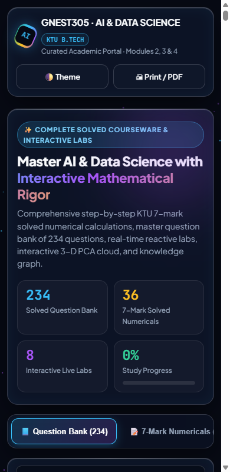

# AI & Data Science Portal: question bank, worked numericals and interactive labs for KTU GNEST305

[](https://creativecommons.org/licenses/by-nc-nd/4.0/)
[](https://ai-data-science-portal.vercel.app/)

## Overview

A single-page study portal for the KTU GNEST305 AI & Data Science course. It bundles a 234-question bank, 36 worked 7-mark numericals, 8 small interactive labs, a 3-D PCA view, a knowledge graph and a rapid quiz. It is static HTML with no build step and no backend, so it opens in any browser.

## Demo

Live: https://ai-data-science-portal.vercel.app/

| 1280 px | 390 px |
|---|---|
|  |  |

## Problem statement

Students revising for the GNEST305 exam need many practice questions with model answers, and numericals worked step by step, in one place that works on a phone. The portal gathers them and adds small labs so students can change the inputs and see the result.

## Approach

`index.html` is one self-contained file: the question data (`QB_DATA`, `NUM_DATA`), styles and scripts are inline. Tabs switch between six sections. The labs compute their results in the browser.

## Data

- **Question bank:** 234 questions in 8 sub-modules, covering Modules 2, 3 and 4 of the syllabus only (Module 1 and 5 are not included).

  | Sub-module | Questions |
  |---|---|
  | Module 2: Linear Algebra, SVD & PCA | 32 |
  | Module 3: Statistics & Estimation (MLE) | 27 |
  | Module 3: Probability & Bayes | 18 |
  | Module 3: Correlation & Regression | 20 |
  | Module 4: Data Science Foundations | 30 |
  | Module 4: Big Data | 22 |
  | Module 4: Data Science Process & k-NN | 40 |
  | Module 4: ML Workflows, Bayes & PCA | 45 |

- **7-mark numericals:** 36, each with a marking breakdown.
- **Labs:** 1 Regression, 2 Bayes theorem, 3 Coin MLE, 4 Eigen transform, 5 Descriptive statistics, 6 k-NN 2-D classifier, 7 PCA explained variance, 8 Custom k-NN playground.
- **Source of the questions:** the repository does not record whether the questions are original or adapted from KTU papers or textbooks. Treat them as study material, and check answers against your textbook.
- **Privacy:** no accounts, no analytics, no student data. The only external request is for Google Fonts.

## Results

| Check | Value | Status | How measured | Date |
|---|---|---|---|---|
| Question bank size | 234 questions | Verified (re-run 2026-10-13) | count of `QB_DATA` items (32+27+18+20+30+22+40+45) | 2026-10-13 |
| Horizontal overflow on `index.html` | 0 px at 390 px and 1280 px | Verified (re-run 2026-10-13) | Playwright, `scrollWidth - clientWidth` | 2026-10-13 |
| Page errors on load | 0 | Verified (re-run 2026-10-13) | Playwright | 2026-10-13 |

Run log: `docs/runs/2026-10-13-mobile-and-privacy-checks.md`.

## Tech stack

HTML, CSS and vanilla JavaScript in a single file. Google Fonts (Plus Jakarta Sans). Deployed to Vercel as a static site (`vercel.json`).

## Getting started

Prerequisites: a modern browser. To serve locally you also need Python 3.

```bash
git clone https://github.com/Janeferdinant/AIIDS.git
cd AIIDS
python -m http.server 8091
```

Open http://localhost:8091. Expected: the "AI & Data Science · Master Academic Portal" page loads with six tabs (Question Bank, 7-Mark Numericals, Interactive Labs, 3-D PCA Cloud, Knowledge Graph, Rapid Quiz). Opening `index.html` directly from disk also works.

How to use it:

1. **Question Bank:** browse by sub-module; each question has Read and Copy buttons.
2. **7-Mark Numericals:** work the question yourself, then compare with the worked solution and marking breakdown.
3. **Interactive Labs:** change the inputs and watch the results update.
4. **Rapid Quiz:** a short multiple-choice self-test.
5. The header has a theme toggle and a Print / PDF button, and the page tracks study progress.

## Project structure

```
AIIDS/
├── index.html                          # the portal (served at the site root)
├── GNEST305_7Mark_Dashboard.html       # earlier dashboard version, not linked from the portal
├── GNEST305_7Mark_Solved.pdf           # 8-page printable set of solved 7-mark questions
├── ai_ds_7mark_numerical(1).html       # earlier drafts of the numericals page, not linked
├── ai_ds_7mark_numerical(3).html
├── ai_ds_question_bank_demo(1).html    # earlier drafts of the question bank, not linked
├── ai_ds_question_bank_demo(4).html
├── seminar_report_review.html          # unrelated to the course, not linked
├── vercel.json
├── docs/                               # run logs and screenshots
└── LICENSE
```

## Real-world applications

Exam revision for GNEST305, and a template for a static, phone-friendly question bank for other courses.

## Limitations

- Covers Modules 2, 3 and 4 only.
- Answers have not been independently checked against the KTU valuation scheme.
- The source of the questions is not recorded in the repository.
- The draft pages are earlier versions of the same content and are not linked from the portal.
- Google Fonts are loaded from the network; offline, the page falls back to system fonts.
- No automated tests; the checks in the run log were run by hand.

## Future scope

- Questions for Modules 1 and 5.
- Source credits for each question.
- Removing or consolidating the draft pages.

## Credits & citation

Prepared by Jane Rose Ferdinant for KTU GNEST305. Fonts: Plus Jakarta Sans via Google Fonts (SIL Open Font License 1.1); see THIRD_PARTY_NOTICES.md. The repository does not record the sources of the questions or whether AI tools were used to produce them; the owner should add that credit.

## License

Original work © Jane Rose Ferdinant, licensed CC BY-NC-ND 4.0. Third-party components retain their own licenses; see THIRD_PARTY_NOTICES.md.

## Author

Jane Rose Ferdinant, Assistant Professor, Department of Computer Science and Engineering.

- Portfolio: https://janeferdinant.vercel.app
- LinkedIn: https://www.linkedin.com/in/janerosenf/
